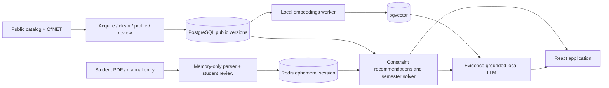
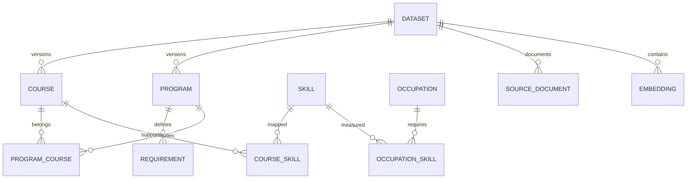

# Architecture and data model

Public tables have versioned identities. Rule expressions preserve AND/OR structure;
minimum-grade and concurrent conditions remain explicit. Requirement allocation prevents
elective double-counting; quantitative/data competency is fulfilled by required mathematics.
The active-version unique index and transaction ensure readers never see partially loaded data.
Representative operations: bulk course lookup by version, course–skill–occupation joins,
and filtered cosine retrieval. Sessions and student-derived results have no SQL tables.

Storage alternatives: relational integrity is useful for academic rules and source versions;
JSON payloads retain irregular document metadata; pgvector shares transactional public-data
storage; Redis fits deliberately short-lived session data. A separate graph or document
database would add operational cost without a demonstrated workload requirement.
