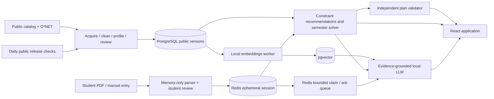
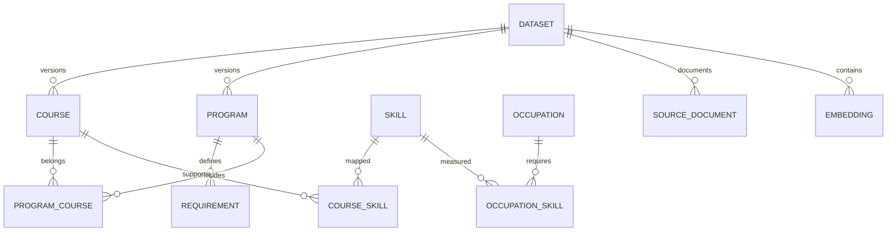

# Architecture and data model

Public tables have versioned identities. Rule expressions preserve AND/OR structure;
minimum-grade and concurrent conditions remain explicit. Requirement allocation prevents
elective double-counting; quantitative/data competency is fulfilled by required mathematics.
The active-version unique index and transaction ensure readers never see partially loaded data.
Representative operations: bulk course lookup by version, course–skill–occupation joins,
and filtered cosine retrieval. Sessions and student-derived results have no SQL tables.

The processing boundary separates reviewed rules from semantic estimates. V3 caches immutable
public snapshots by dataset version and mapping generation, while checking the active version
on every read. Private caches also include academic revision and expire within the session's
remaining lifetime. Serialized JSON bypasses repeated generic response encoding. Catalog search
uses PostgreSQL trigram and version indexes; unresolved rule review is paginated. COPY staging
and foreign keys validate a new public version before a single transaction activates it.

Every successful uncached semester plan passes a separate validator for prerequisites, grades,
concurrent bundles, load limits, pins, term sequencing, allocation, lab pairing and credit totals.
Cached plans reuse that validated version/revision result. Permission conditions, missing courses
and unreviewed rules do not become eligible through embeddings or language-model output.

The explanation worker claims jobs atomically into a processing list and recovers interrupted
claims after restart. Revision/session checks make deletion final. A separate public worker
checks active-version changes every 30 seconds and reuses unchanged embeddings. The local
embedding process sets actual Torch thread limits. The language model is identity-checked and
its public excerpt/citation output is constrained and validated; private reasoning stays local.
Unrecognized or invalid output falls back to deterministic explanations.

Current public retrieval scans exactly over the small active corpus. HNSW is available for
explicitly qualified larger corpora, with iterative scans and documented synthetic recall results.
High-selectivity benchmark filters use exact fallback. Real-corpus ANN remains opt-in; the
synthetic qualification is not a guarantee of real-world skill matching quality.

Storage alternatives: relational integrity is useful for academic rules and source versions;
JSON payloads retain irregular document metadata; pgvector shares transactional public-data
storage; Redis fits deliberately short-lived session data. A separate graph or document
database would add operational cost without a demonstrated workload requirement.
